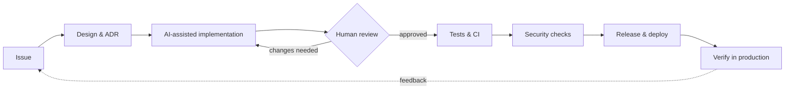

<div align="center">


<a href="https://github.com/BrahimNJ">
  
</a>

<p>
  <a href="https://linkedin.com/in/brahimnaji"></a>
  <a href="mailto:brahim.naji.pro@gmail.com"></a>
</p>

<p>
  <a href="https://invoice-flow-brahim21.vercel.app"></a>
  <a href="https://devpulse-865877702597.europe-west1.run.app"></a>
</p>


</div>

---

## 👋 About me

Software engineer with a **State Engineering Degree** (ENSET Mohammedia) and an **MSc in Software Engineering** (Université de Lorraine).
I build fullstack applications end to end, and I care about the parts that make software last: clear architecture, tests, security and a delivery pipeline you can trust.

```text
Architecture  →  Backend  →  Frontend  →  Security  →  CI/CD  →  Production
```

- 🏭 **Nexen Tech**: designed a multi-vendor abstraction API; 4 vendors with different protocols, plugged in without touching the shared core
- 🧾 **InvoiceFlow**: e-invoicing app for French SMEs, live in production, **172 automated tests**
- 📊 **DevPulse**: GitHub repository analytics, live on **Google Cloud Run**, infrastructure as code with **Terraform**, **13 architecture decision records**
- 🔐 Comfortable with **Keycloak, OAuth2/OIDC, JWT refresh-token rotation, Vault**
- 🤖 I use **Claude Code** as a coding agent, and I only ship code I can explain

---

## 🚀 Featured projects

<table>
<tr>
<td width="50%" valign="top">

### 🧾 [InvoiceFlow](https://github.com/BrahimNJ/InvoiceFlow)

Invoicing app built for the French e-invoicing reform (2026-2027).

- ✅ Live: accounts, customers, products & services with French VAT rates
- 🔐 JWT (15 min) + rotating refresh tokens with reuse detection (RFC 9700)
- 🧪 **172 tests** · every green merge is deployed **and verified in production**
- 🗺️ Next: invoices & payments → PDF / Factur-X → AI assistant

`Java 21` `Spring Boot 4` `Angular 21` `PostgreSQL 17` `Flyway` `Docker` `GitHub Actions`

[**▶ Live demo**](https://invoice-flow-brahim21.vercel.app) · [Source](https://github.com/BrahimNJ/InvoiceFlow)

</td>
<td width="50%" valign="top">

### 📊 [DevPulse](https://github.com/BrahimNJ/DevPulse)

Type any public GitHub repository and see how healthy it is and how fast it ships.

- 🌿 **Branches**: stale work, protections (rules _and_ rulesets), divergence from the default branch
- 🚚 **Delivery**: DORA-style metrics over 90 days: lead time, review time, throughput, releases, revert rate
- 📈 **Activity**: a year of commits, contributor flow, concentration and project rhythm
- 🧱 React app, HTTP API **and** CLI on one I/O-free domain · **188 tests** · FR / EN
- ☁️ Cloud Run + Terraform · per-visitor quota · automated releases (v0.11)

`TypeScript` `Node.js 24` `React 19` `Vite` `GraphQL` `GCP` `Terraform`

[**▶ Live demo**](https://devpulse-865877702597.europe-west1.run.app) · [Source](https://github.com/BrahimNJ/DevPulse)

</td>
</tr>
</table>

---

## 🛠️ Tech stack

**Backend**
<br/>


**Frontend**
<br/>


**Data**
<br/>


**DevOps & Cloud**
<br/>


**Security**
<br/>


---

## 🧠 How I build software

AI speeds up the typing. Engineering decides what gets shipped.



- **Decisions on record**: every technical choice is an ADR with the alternatives rejected and why
- **Small steps**: one issue per change, atomic Conventional Commits, one pull request
- **Guardrails**: the agent never merges, never pushes to `main`, never touches secrets or cloud resources
- **Proof over promises**: tests, CI gates (lint, types, secret scanning, dependency audit) and post-deploy checks decide, not the model

---

## 🔭 Right now

- 🧾 Shipping **invoices & payments** in InvoiceFlow, then **Factur-X** export
- 🧩 Next: an **AI assistant**: a sentence in, a draft invoice out (structured output, tests, human confirmation)
- 📊 Growing **DevPulse** after branches, delivery and activity: next analyses are specified as issues before they are built
- ☸️ Running InvoiceFlow on **Kubernetes** with Helm
- 💼 Looking for a **software engineer / fullstack** role in France

---

<div align="center">

**Let's talk**: [LinkedIn](https://linkedin.com/in/brahimnaji) · [brahim.naji.pro@gmail.com](mailto:brahim.naji.pro@gmail.com)


</div>
